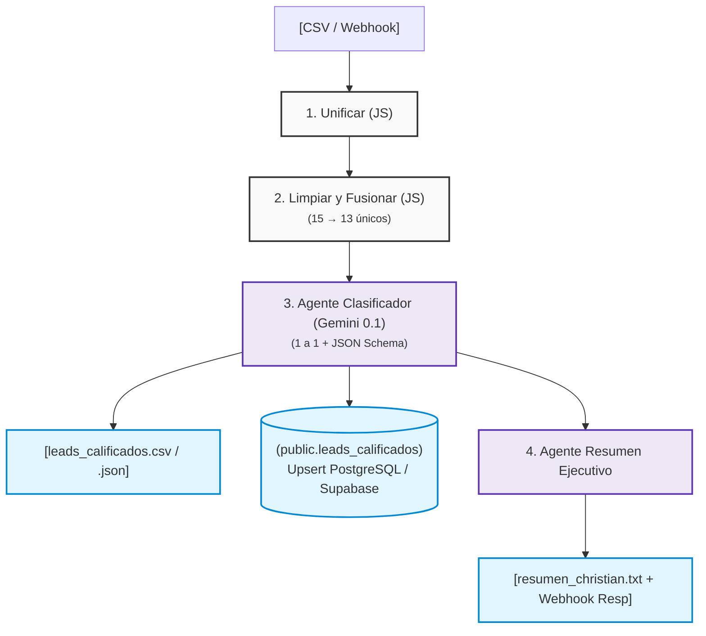

# DARHE — Pipeline de Limpieza, Calificación y Priorización de Leads (n8n + IA)

Sistema automatizado que **limpia, deduplica, califica (`A`, `B`, `C`, `Descartado`) y prioriza** los leads entrantes de DARHE (web, WhatsApp, redes y referidos), generando la base consolidada y el plan de llamadas de 1 página para Christian (Área Comercial).




### 📦 Mapa de Entregables

| Entregable Solicitado | Archivo en este Repositorio |
| :--- | :--- |
| **1. Flujo de n8n exportado** | [`workflows/workflow_n8n_darhe.json`](workflows/workflow_n8n_darhe.json) |
| **2. Archivos de salida calificados** | [`data/output/leads_calificados.csv`](data/output/leads_calificados.csv) y [`leads_calificados.json`](data/output/leads_calificados.json) |
| **3. Resumen para Christian (1 pág.)** | [`data/output/resumen_christian.txt`](data/output/resumen_christian.txt) *(Texto plano listo para enviar por correo)* |
| **4. Bitácora de IA** | [`docs/bitacora_ia.md`](docs/bitacora_ia.md) |
| **5. Extras Opcionales (SQL + Webhook + LLM)** | [`sql/01_supabase_schema.sql`](sql/01_supabase_schema.sql) + [`feeder/send_webhook.py`](feeder/send_webhook.py) + Nodos Gemini |

---

## 🚀 1. Cómo correrlo (3 Modalidades)

> **Seguridad:** No se incluyen llaves en el repositorio (`.env` está en `.gitignore`). Para correrlo localmente, copia la plantilla:
> ```bash
> cp .env.example .env   # Coloca ahí tu GEMINI_API_KEY
> ```

### Opción A: Prueba en Vivo en VPS (Cero instalación)
El entorno está desplegado y activo para pruebas inmediatas:
* **UI n8n / Endpoint Base:** `http://69.48.201.220:5677`
User_example: 'ulises_arroyo@darhe.com'
Pass_example: 'mFm7V=1R2r'
* **Disparar un lead de prueba al Webhook:**
  ```bash
  curl -X POST http://69.48.201.220:5677/webhook/darhe-leads -H "Content-Type: application/json" -d '{"leads": [{"id": 99, "fecha": "2026-10-25", "nombre": " ROBERTO DIAZ ", "empresa": "Autotransportes Díaz", "email": "rdiaz@transdiaz.mx", "telefono": "55 8899 7766", "segmento": "transportista", "num_empleados": "85", "ciudad": "Querétaro", "fuente": "WhatsApp", "mensaje": "Necesitamos controlar diésel y viáticos de 85 unidades, ¿tienen demo?"}]}'
  ```

### Opción B: Stack Completo con Docker Compose (Recomendada)
Levanta **n8n** (`:5677`), **PostgreSQL** (`:5432`) y un contenedor emisor (**`lead-feeder`**) que inyecta los 15 leads del CSV vía Webhook:
```bash
docker compose up -d --build
docker compose --profile webhook-test run --rm lead-feeder
```
* **Qué hace el arranque automático (`entrypoint.sh`):** De forma idempotente inicializa la tabla `public.leads_calificados`, registra las credenciales locales desde `.env` e importa/activa el workflow sin duplicarlo en reinicios.
* También puedes entrar a `http://localhost:5677`, abrir el workflow y pulsar **Execute workflow** (disparo manual leyendo `/data/input/leads_test_darhe.csv`).

### Opción C: Contenedor Autónomo (Solo `Dockerfile`, sin Postgres externo)
```bash
docker build -t darhe-n8n-automation:1.0.0 .
docker run -d --name darhe-n8n -p 5677:5677 --env-file .env -v $(pwd)/data:/data darhe-n8n-automation:1.0.0
```
*(Usa SQLite interno y genera los archivos `.csv`, `.json` y `.txt` en `./data/output`).*

---

## 🧠 2. Reglas de Limpieza, Deduplicación y Supuestos de Negocio

Separamos responsabilidades: **JavaScript determinista** para limpiar y unir datos duros (cero alucinaciones), y **LLM (Gemini con temperatura `0.1` + Structured Outputs)** evaluando **1 lead a la vez** para interpretar el campo `mensaje`.

### Limpieza y Fusión de Duplicados (*Field-Level Survivorship*)
* **Nombres:** Se conserva acentuación; si viene en `MAYÚSCULAS` se normaliza a `Title Case`.
* **Teléfonos:** Se limpian símbolos, se remueve el prefijo `52` en números de 12 dígitos y se formatea a `+52` + 10 dígitos (`+52XXXXXXXXXX`). Cadenas falsas (`0000000000`) o $<10$ dígitos se vacían.
* **Correos:** Validación sintáctica `usuario@dominio.tld`. Detecta truncados como `ana.torres@pilar` (inválido) y acepta `.example` (dominio de prueba RFC 2606).
* **Segmentos:** Homologados a `transportista`, `restaurantero` (incluye `restaurant`), `construcción` (corrige `construccion`), `empresario` y `hotelería`.
* **Unión de Duplicados (15 filas $\rightarrow$ 13 leads únicos):** Agrupados por teléfono normalizado. Sobrevive el ID más antiguo, registrando el absorbido en `duplicado_de` y conservando **el mejor dato de cada columna**:
  * **IDs `1 + 3` (Laura Méndez):** Queda **ID 1** (`duplicado_de: "3"`), nombre con tilde, razón social completa (`SA de CV`), une fuentes (`formulario web, WhatsApp`) y concatena mensajes cronológicamente.
  * **IDs `4 + 14` (Ana Torres):** Queda **ID 4** (`duplicado_de: "14"`). El ID 4 tenía el dolor claro (*"pago a cuadrillas... demo"*) pero email roto y sin empleados; del ID 14 rescata el email válido (`@pilar.example`) y los `45` empleados, convirtiendo dos registros incompletos en un **Lead Categoría A**.

### Supuestos en Casos Grises (Marcados con `requiere_revision = true`)

| ID | Caso Detectado en el Dataset | Decisión Tomada y Supuesto | Calificación | ¿Revisión? |
| :---: | :--- | :--- | :---: | :---: |
| **1** | Columna reporta `120` empleados; mensaje menciona `90 operadores`. | Ambos superan el umbral ($\ge 20$), pide cotización urgente e insistió por WhatsApp. | **A** | **Sí** *(validar total)* |
| **4** | Fusión de `ID 4` (web) + `ID 14` (LinkedIn). | Con los datos rescatados del ID 14 cumple segmento, tamaño (`45`), contacto y pide demo. | **A** | No |
| **9** | Columna dice `18` empleados ($<20$), pero mensaje dice *"60 eventuales en noviembre. Urge"*. | Se prioriza el volumen operativo real del mensaje (`60`) para no perder una obra urgente. | **A** | **Sí** *(criterio eventuales)* |
| **12** | Columna `num_empleados` corrupta (`"abc"`), mensaje dice *"Somos como 60"*. | El LLM extrae `60` del texto y detecta dolor concreto (control de gasolina). | **A** | **Sí** *(confirmar flota)* |
| **6** | `250` empleados y llega por **referido**, pero no describe dolor ni pide demo. | Por regla estricta es **B**, pero se destaca en el resumen como **Prioridad #5 VIP**. | **B** | **Sí** *(abordaje VIP)* |
| **8** | Transportista de `35` empleados por WhatsApp (`"Llámenme"`), sin email. | Es contactable por teléfono, pero falta correo y la necesidad es vaga. | **B** | **Sí** *(datos incompletos)* |
| **10** | Restaurantero con `40` empleados; escribe pregunta general en **inglés**. | Cumple tamaño y giro, pero la necesidad es exploratoria y requiere atención bilingüe. | **B** | **Sí** *(asignar bilingüe)* |
| **13** | Restaurantero (`25` emp.) por Instagram con `@gmail.com`: *"¿Cuánto cuesta?"*. | Pregunta aislada de precio sin contexto operativo desde correo personal; se deja en **B**. | **B** | **Sí** *(¿A o B?)* |
| **15** | Hotel de `70` empleados con rotación alta (segmento `hotelería`). | Fuera de los 4 giros explícitos (**C**), pero Christian debe decidir si entra como *Empresario*. | **C** | **Sí** *(evaluar giro)* |
| **7** | Despacho contable de `8` empleados: *"Busco opciones para mis clientes"*. | Menos de 20 empleados propios (**C**), pero alto potencial como **alianza/canal B2B**. | **C** | **Sí** *(evaluar alianza)* |
| **2** | Restaurante de `12` empleados, mensaje *"Info"*. | Menos de 20 empleados y sin urgencia. | **C** | No |
| **11** | `"Competencia Monederos SA"` pide precios y comisiones a detalle. | Bloqueado por ser **competidor directo** (*mystery shopper*). | **Descartado** | **Sí** *(confirmar bloqueo)* |
| **5** | `"Win Big"` (`ganadinero@spam.example`), tel `0000000000`, *"Gana $$$"*. | Spam evidente y sin medio de contacto válido. | **Descartado** | No |

---

## 🛡️ 3. ¿Qué pasa si llega un lead roto?

* **Valores nulos o basura (`null`, `NaN`, `None`, `""`):** Se normalizan a cadena vacía sin interrumpir el lote.
* **Caracteres invisibles de codificación (BOM `\ufeff`):** El primer nodo sanitiza las llaves del objeto para que encabezados como `"\ufeffid"` no rompan el mapeo.
* **Teléfono inválido o vacío:** No se usa como llave de agrupación (se le asigna `no_phone_<id>`), evitando fusionar por error dos prospectos distintos que no dejaron teléfono.
* **Texto en campos numéricos (`num_empleados = "abc"`):** Se captura sin error (`num_empleados_reportado = null`), el Agente IA extrae el número si existe en el mensaje y activa `requiere_revision = true`.
* **Caída o falta de respuesta del LLM:** El generador del resumen para Christian cuenta con un **motor de respaldo determinista en JS** que construye el mismo reporte en texto plano si el nodo de IA falla.
* **Idempotencia en re-ejecución:** Los archivos en `/data/output` se actualizan limpiamente y PostgreSQL ejecuta `INSERT ... ON CONFLICT (id) DO UPDATE` (Upsert), evitando registros duplicados.

---

## ✅ 4. Cómo comprobé que funciona

1. **Paridad Manual vs. Webhook:** Ejecuté el flujo desde la UI de n8n (leyendo el CSV local) y mediante el contenedor `lead-feeder` (vía HTTP POST al Webhook); ambos caminos produjeron exactamente los **13 leads únicos**.
2. **Auditoría de Supervivencia de Datos:** Comprobé en `leads_calificados.json` que el `ID 1` absorbió al `3` (`duplicado_de: "3"`) y el `ID 4` absorbió al `14` (`duplicado_de: "14"`), rescatando el correo válido y los 45 empleados.
3. **Verificación en Base de Datos (PostgreSQL):**
   ```bash
   docker exec -it darhe-postgres-db psql -U darhe_admin -d darhe_crm \
     -c "SELECT calificacion, COUNT(*), SUM(requiere_revision::int) AS en_revision FROM leads_calificados GROUP BY 1 ORDER BY 1;"
   ```
4. **Validación de Formato Comercial:** Verifiqué que `resumen_christian.txt` no contenga sintaxis Markdown cruda (`**`, `#`), sea menor a una cuartilla y ordene las prioridades empezando por los casos urgentes.

---

## 🗺️ 5. Qué haría con dos semanas más

1. **Flujo *Human-in-the-Loop* con Envío de Correo y Botones de Aprobación:** Enviar automáticamente `resumen_christian.txt` por Gmail/SMTP o Slack a Christian con botones interactivos (*"Aprobar llamada"*, *"Reclasificar a A"*, *"Bloquear"*) que actualicen la columna `validado_por_christian` en base de datos antes de disparar mensajes al prospecto.
2. **Guardrails Híbridos Post-LLM:** Agregar una capa de validación dura después del Agente IA (ej. prohibir por código que un lead sin teléfono ni email reciba calificación `A` o `B` aunque el LLM se equivoque) y marcar `requiere_revision = true` automáticamente ante cualquier timeout de la API.
3. **Deduplicación Difusa (*Fuzzy Matching*) Histórica contra Base de Datos:** Cruzar nuevos leads entrantes contra todo el histórico en PostgreSQL/Supabase comparando no solo teléfono exacto, sino también correo y similitud de nombre + empresa (distancia de Levenshtein / trigramas `pg_trgm`).
4. **Suite de Pruebas de Regresión en CI/CD:** Configurar GitHub Actions con un dataset de prueba ("Golden Dataset") y casos extremos para validar que ningún cambio de prompt altere las calificaciones esperadas.